# Infosys Springboard Internship 7.0 (Batch 4) — Milestone 1
# Franchise Management System: Secure User Authentication & Access Management Module

**Tech Stack:** Python 3.11 · Streamlit · JSON Web Tokens (PyJWT) · SQLite3 · bcrypt · Two-Factor Gmail OTP · Google Gmail API (OAuth 2.0 HTTPS / STARTTLS SMTP) · ngrok · Google Colab Secrets

[](https://www.python.org/)
[](https://streamlit.io/)
[](https://jwt.io/)
[](#otp-verification-and-wrong-otp-handling)
[-success.svg)](#security-architecture)
[](#final-milestone-1-checklist)

---

## 📖 Executive Summary
Milestone 1 serves as the enterprise security foundation for the **Franchise Management System**. It delivers a high-security, multi-role user authentication, Two-Factor OTP verification, and franchise administration platform built natively in **Python** and **Streamlit**.

The system implements strict defense-in-depth security standards:
- **Two-Factor Authentication (2FA / OTP Verification):** Every login requires a cryptographically generated 6-digit numeric OTP delivered to the registered email address with strict 10-minute validity.
- **Robust Wrong OTP Handling:** Incorrect OTP submissions display a clear, standardized error: `"Invalid OTP. Please try again."` Login is strictly blocked on incorrect OTP, allowing retries with maximum attempt rate limiting (locked after 5 incorrect entries).
- **OTP Resend & Self-Service Flow:** Resend OTP functionality with cooldown controls, older token invalidation, and seamless navigation between Login, OTP Verification, and Password Recovery.
- **Cryptographic JWT (JSON Web Tokens):** Post-verification session authorization via HS256 signed JWT tokens containing claims, role permissions, and active expiration verification.
- **Strong Hashing (bcrypt & SHA-256):** User passwords salted and hashed via bcrypt (12 rounds). Security answers normalized and hashed via SHA-256 for privacy.
- **Dual-Route Self-Service Password Recovery:** Account recovery supported via registered Security Questions or real-time Gmail OTP verification.
- **Role-Based Access Control (RBAC):** Distinct dashboards for Franchise Partners and System Administrators. Strictly adheres to audit compliance (passwords and hashes are completely redacted from administrative views).
- **Interactive Franchise Management Modules:** Operational franchise outlets directory, inventory and supply requisitions, and franchise territory expansion applications.
- **Zero-Credential Hardcoding Policy:** Native integration with Google Colab Secrets and local environment files (`.env`). Actual OTP codes and secrets are never exposed in logs or user screens.

---

## 🏛️ System Architecture & Authentication Flow

```
                                      +-----------------------------------+
                                      |    Franchise Management System    |
                                      |      Streamlit Web Platform       |
                                      +-----------------+-----------------+
                                                        |
                         +------------------------------+------------------------------+
                         |                              |                              |
                         v                              v                              v
               +-------------------+          +-------------------+          +-------------------+
               |    User Login     |          |  Franchise Signup |          |  Forgot Password  |
               | (Anti-Enumeration)|          | (Regex Validation)|          | (SQ / Gmail OTP)  |
               +---------+---------+          +---------+---------+          +---------+---------+
                         |
                         v [Valid Credentials]
               +--------------------------------------------------+
               |        Two-Factor OTP Verification Gate          |
               | - Generates 6-Digit Code (10-min expiration)     |
               | - Dispatches to Registered Email (Masked UI)     |
               | - Tracks Failed Attempts (Max 5 Limit)           |
               +-------------------------+------------------------+
                                         |
                    +--------------------+--------------------+
                    |                                         |
                    v [Correct OTP Entered]                   v [Incorrect OTP Entered]
       +----------------------------+            +----------------------------+
       |   Issue Signed JWT Token   |            | Display:                   |
       | - Algorithm: HS256         |            | "Invalid OTP.              |
       | - Lifetime: 2 Hours        |            |  Please try again."        |
       | - Claims: sub, email, role |            | - Block Verification       |
       +--------------+-------------+            | - Retry Allowed            |
                      |                          | - Resend OTP Option        |
         +------------+------------+             | - Forgot Password Option   |
         |                         |             | - Back to Login Option     |
         v                         v             +----------------------------+
+-------------------+     +-------------------+
|  User Dashboard   |     |  Admin Dashboard  |
| - Franchise Hub   |     | - Users Directory |
| - Outlets Network |     |   (Redacted Pwds) |
| - Supply Orders   |     | - Franchise Audit |
| - New Application |     | - Mailer Health   |
+-------------------+     +-------------------+
```

---

## 🔐 1. OTP Verification and Wrong OTP Handling (Guide Feedback Addressed)

### Expected Flow Implementation

$$\text{Login} \longrightarrow \text{OTP Verification} \longrightarrow \text{Validate OTP}$$

1. **Step 1: Primary Authentication**
   - User inputs Username/Email and Password on the Login page.
   - Credentials are authenticated against bcrypt password hashes in SQLite.
   - If invalid, outputs generic `"Invalid username/email or password."` to eliminate user enumeration.
   - If valid, generates a secure 6-digit numeric OTP, stores it in the `otps` database table with a 10-minute expiry timestamp, records `purpose='login'`, and dispatches it via Google Gmail API / SMTP.
   - User transitions to the dedicated **Two-Factor OTP Verification** view.

2. **Step 2: Correct OTP Verification**
   - User enters the 6-digit code received on their registered email.
   - Backend checks database: confirms code match, unexpired status (`time.time() <= expires_at`), unconsumed status (`used == 0`), and attempts threshold (`attempts < 5`).
   - On match, OTP is consumed (`used = 1`), a signed JWT session token is generated, and the user is redirected to the **User Dashboard**.

3. **Step 3: Incorrect OTP Handling**
   - When an incorrect OTP is entered, displays the exact standardized error:
     ```
     ❌ Invalid OTP. Please try again.
     ```
   - Does not allow login or dashboard access under any circumstance.
   - The user remains on the verification page and is permitted to re-enter and retry the OTP.
   - Multiple incorrect attempts are tracked in the database: if 5 consecutive failed attempts occur, the OTP is automatically invalidated/locked with an alert: `"Maximum incorrect attempts exceeded. This OTP has been invalidated. Please request a new OTP."`

4. **Step 4: Resend OTP Option**
   - A dedicated **🔄 Resend OTP** button generates a fresh 6-digit OTP, marks previous unused OTPs as invalidated, resets the 10-minute validity timer, and dispatches a fresh notification email.
   - Includes a 15-second cooldown timer to prevent accidental duplicate requests.

5. **Step 5: Forgot Password & Back to Login Redirection**
   - A **🔄 Forgot Password?** button immediately redirects to the self-service Password Recovery module.
   - A **⬅️ Back to Login** button cancels the pending 2FA login session and safely returns to the login screen.

6. **Step 6: Security and Privacy Protection**
   - **Never exposes the actual OTP** in frontend error messages, URL parameters, terminal console, or application logs.
   - Displays user email in masked form (e.g., `p*****r@franchise.com`) to protect PII.
   - Enforces frontend and backend validation against empty submissions, non-numeric characters, and length mismatches.

---

## 🏢 2. Franchise Management Modules

The application features full-featured business operational modules:
1. **Franchise Outlets Directory:** Filterable registry of nationwide franchise locations (e.g., Bengaluru Hub, Mumbai Express, Delhi Central, Hyderabad Tech City, Chennai Marina) with revenue metrics, royalty rates, and operational statuses (`Active ✅`, `Under Audit 🔍`).
2. **Supply & Inventory Requisitions:** Operational store supply tracker for branded packaging, POS hardware terminals, uniform sets, and store display boards with interactive ordering.
3. **Franchise Territory Application:** Self-service franchise expansion application portal for partners seeking new outlet licenses.
4. **Administrative Audit Center:** Central control panel for system evaluators and administrators featuring registered partner directory with **strict compliance redaction of passwords and password hashes**, outlet network oversight, and mailer health diagnostics.

---

## 📸 3. Screenshots & Visual Verification

### 1. User Login Page
Displays mandatory credentials input, anti-enumeration protection, and branded Franchise Management System theme.
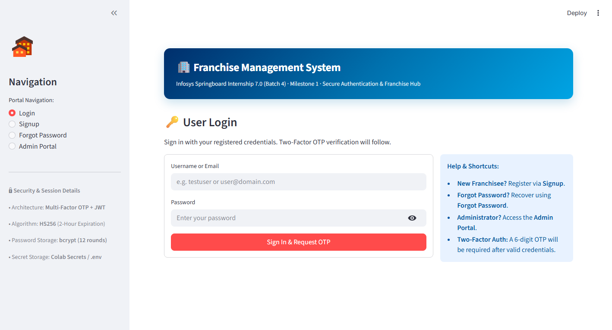

---

### 2. Franchise Partner Registration (Signup Page)
Enforces unique username and email constraints, strict `ab@cd.ef` email structure, 5-point password complexity, and SHA-256 hashed security questions.
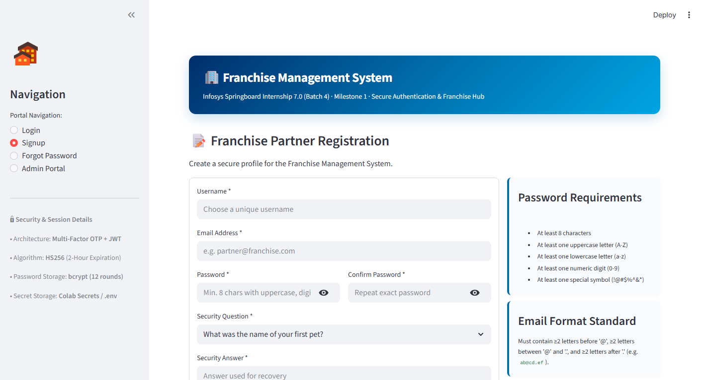

---

### 3. Two-Factor OTP Verification Page
Presents masked email address, 10-minute expiry notice, single-digit inputs, Resend OTP, Forgot Password redirect, and Back to Login controls.
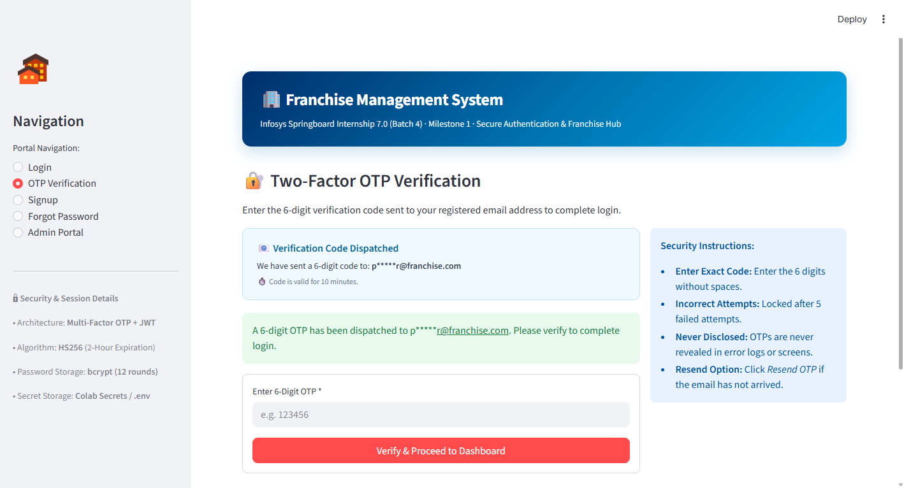

---

### 4. Incorrect OTP Error Handling
Demonstrates strict security enforcement and standardized error banner: `"Invalid OTP. Please try again."` when an incorrect OTP is entered.
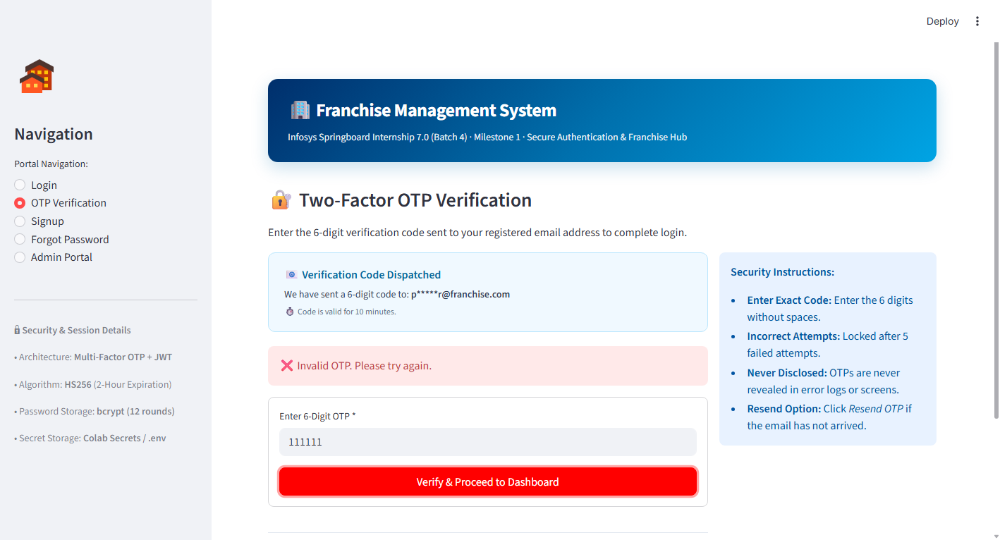

---

### 5. Password Recovery — Security Question Route
Enables verified account recovery via user-configured security question and case-insensitive hashed answer verification.
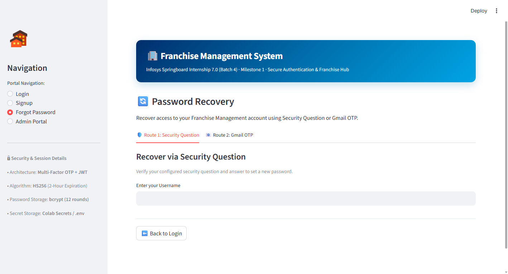

---

### 6. Password Reset — Gmail OTP Route
Generates time-bounded OTP and validates password complexity before updating password in persistent SQLite storage.
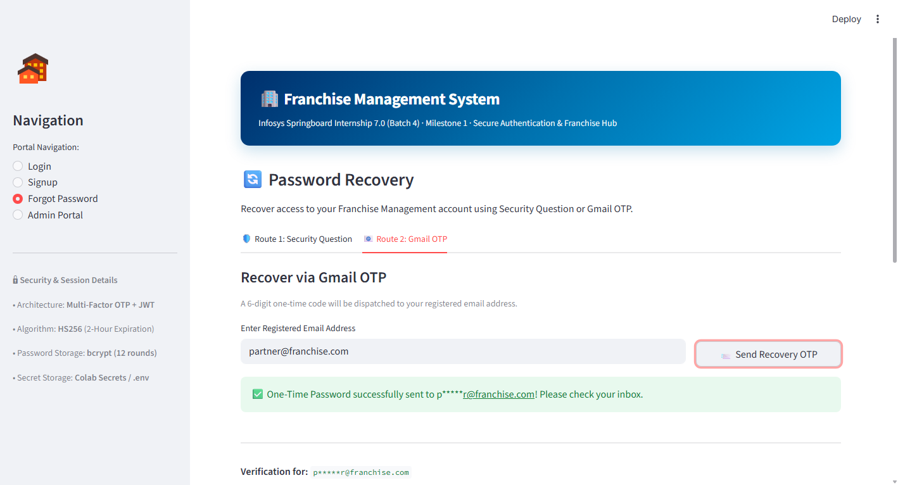

---

### 7. User Dashboard & Active JWT Session
Accessible exclusively with a valid, cryptographic JWT session token (`HS256`). Shows decoded payload, expiration countdown, and milestone progress checklist.
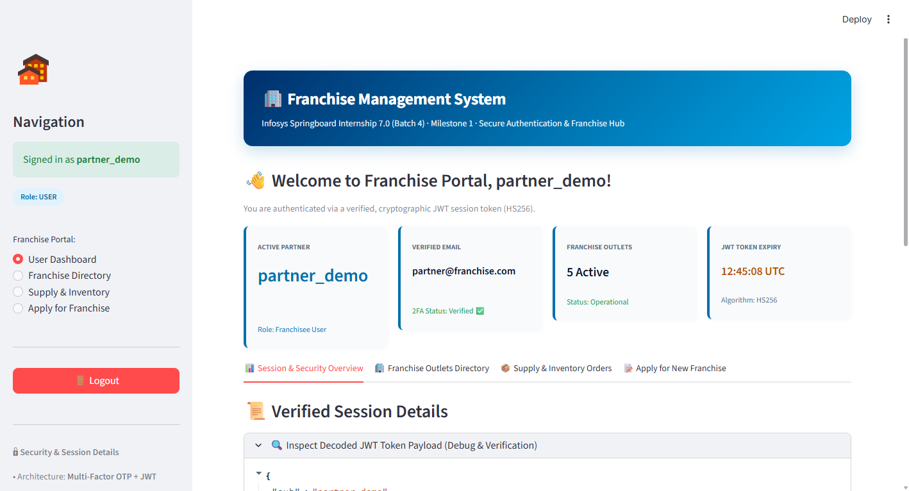

---

### 8. Franchise Management Pages (Outlets Directory)
Comprehensive directory of franchise network stores with location details, monthly revenue figures, royalty percentages, and live search.
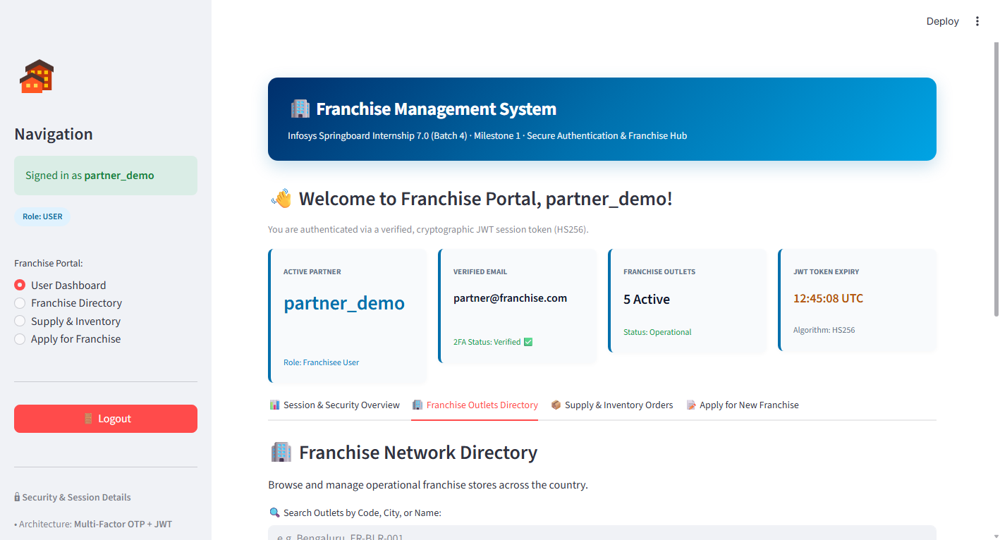

---

### 9. Franchise Supply & Inventory Orders Module
Store inventory supply ordering, item dispatch tracking, and fulfillment workflow for franchise partners.
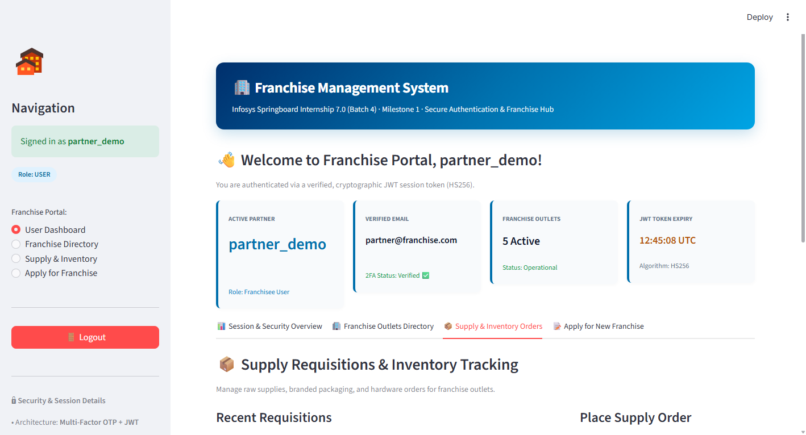

---

### 10. Franchise Territory Expansion Application
Application submission portal for prospective partners applying for new franchise territories.


---

### 11. Administrator Portal Gate
Dedicated administrative authentication checkpoint using constant-time comparison against configured credentials.
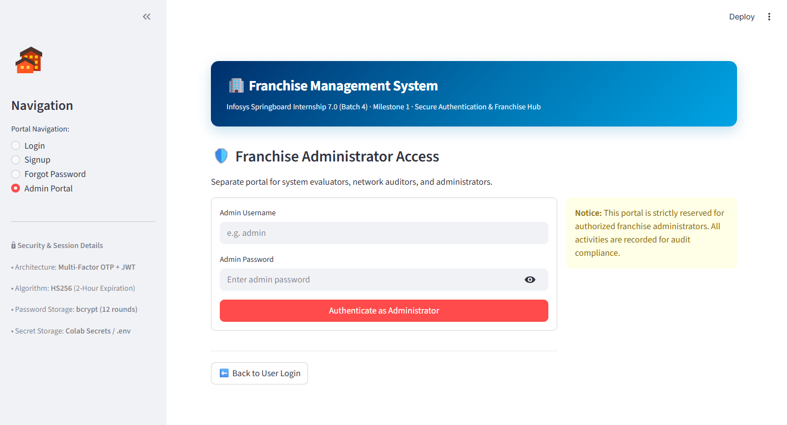

---

### 12. Administrator Dashboard & Registered Users Directory
Administrative control center with total user metrics, franchise network revenue, and registered users directory. **Password data and hashes are strictly redacted.**


---

### 13. Admin Franchise Network Operations & Applications
Administrative oversight of all franchise branches and submitted franchise license applications review queue.
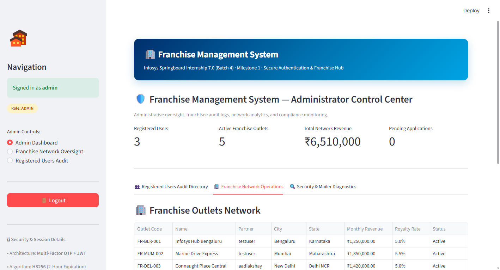

---

## 🗂️ Project Directory Structure

```
Infosys_Agentic_AI/
├── screenshots/                     # Application screenshots (root directory)
│   ├── login-page.png
│   ├── registration-page.png
│   ├── otp-verification-page.png
│   ├── incorrect-otp-error.png
│   ├── forgot-password-page.png
│   ├── password-reset-page.png
│   ├── user-dashboard.png
│   ├── franchise-management-page.png
│   ├── franchise-inventory-orders.png
│   ├── franchise-application-module.png
│   ├── admin-portal.png
│   ├── admin-dashboard.png
│   └── admin-franchise-network.png
└── Milestone1/
    ├── app.py                       # Multi-page Streamlit app (2FA OTP, Franchise Hub, Admin)
    ├── auth.py                      # JWT (HS256) session manager, bcrypt, validation engine
    ├── database.py                  # SQLite3 manager: users, OTP attempts, franchise schema
    ├── mailer.py                    # Gmail OAuth 2.0 API & SMTP delivery with sanitization
    ├── config.py                    # Colab Secrets & .env credential loader
    ├── requirements.txt             # Project dependencies
    ├── .env.example                 # Configuration template
    ├── Milestone1_Authentication.ipynb # Complete Google Colab notebook (synchronized)
    ├── README.md                    # Project documentation (this file)
    └── screenshots/                 # Mirrored verification screenshots
```

---

## 💻 How to Run the Application

### Option A: Local Execution (Windows / macOS / Linux)

1. Navigate to the `Milestone1` directory:
   ```bash
   cd Milestone1
   ```

2. Create and activate a Python virtual environment:
   ```bash
   python -m venv venv
   # On Windows:
   venv\Scripts\activate
   # On Linux/macOS:
   source venv/bin/activate
   ```

3. Install project dependencies:
   ```bash
   pip install -r requirements.txt
   ```

4. Launch the Streamlit application:
   ```bash
   streamlit run app.py
   ```

5. Access the app in your browser at `http://localhost:8501`.

### Option B: Google Colab Execution

1. Open [Google Colab](https://colab.research.google.com/).
2. Upload `Milestone1_Authentication.ipynb`.
3. Configure the required secrets under the **Secrets (Key Icon)** sidebar tab (`JWT_SECRET`, `EMAIL_ADDRESS`, `GMAIL_CLIENT_ID`, `GMAIL_CLIENT_SECRET`, `GMAIL_REFRESH_TOKEN`, `NGROK_AUTHTOKEN`).
4. Run all cells sequentially. Streamlit will launch with a live public `ngrok` URL.

---

## ✅ Final Milestone 1 Verification Checklist

| Step | Requirement | Status | Verification Detail |
|---|---|:---:|---|
| **Step 1** | Repository & `Milestone1` structure | ✅ **PASS** | Organized modular repository structure |
| **Step 2** | Comprehensive `README.md` documented | ✅ **PASS** | Complete architecture, 2FA OTP flow, screenshots & setup guide |
| **Step 3** | Authentication Pages in Streamlit | ✅ **PASS** | Login, 2FA OTP, Signup, Forgot Password, Admin Portal |
| **Step 4** | ngrok Public Tunnel Integration | ✅ **PASS** | Integrated `pyngrok` tunnel for remote access |
| **Step 5** | Gmail OTP Delivery | ✅ **PASS** | Gmail OAuth 2.0 API (HTTPS:443) & SMTP STARTTLS fallback |
| **Step 6** | Zero Hardcoded Secrets Policy | ✅ **PASS** | Colab Secrets & `.env` configuration |
| **Step 7** | Cryptographic JWT Session Management | ✅ **PASS** | `HS256` signed token issuance, expiry check, and session purge |
| **Step 8** | Mandatory, Email (`ab@cd.ef`) & Password Validation | ✅ **PASS** | Strict email regex, 8+ chars, uppercase, lowercase, number, symbol |
| **Step 9** | Dual-Route Password Recovery | ✅ **PASS** | Security Question route + Gmail OTP recovery |
| **Step 10**| **Two-Factor OTP Verification & Invalid Handling** | ✅ **PASS** | **"Invalid OTP. Please try again."**, retry allowed, resend, forgot password, back to login |
| **Step 11**| Dedicated Admin Portal | ✅ **PASS** | Registered users audit with passwords strictly redacted |
| **Step 12**| Franchise Management Operational Pages | ✅ **PASS** | Outlets directory, supply requisitions, territory applications |
| **Step 13**| Application Screenshots in `screenshots/` | ✅ **PASS** | 13 high-resolution screenshots in root and `Milestone1/` |

---

**Author:** Infosys Springboard Intern  
**Program:** Infosys Springboard Internship 7.0 (Batch 4)  
**Project:** Franchise Management System  
**Milestone:** 1 (User Authentication & Access Management Module)
